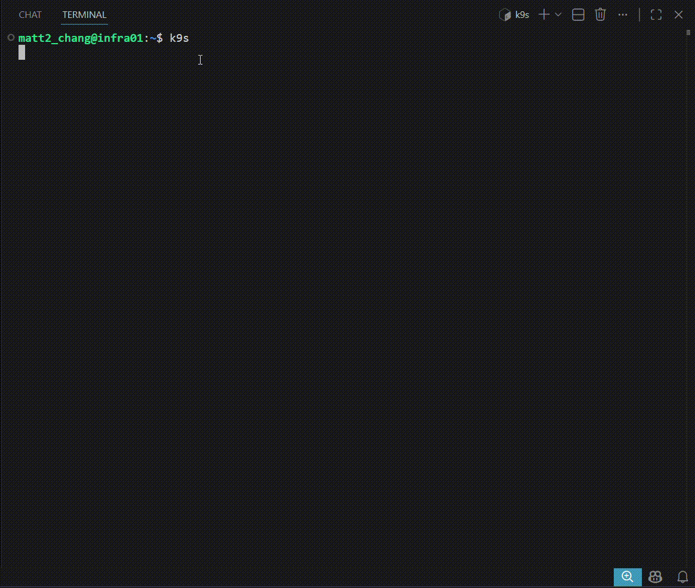
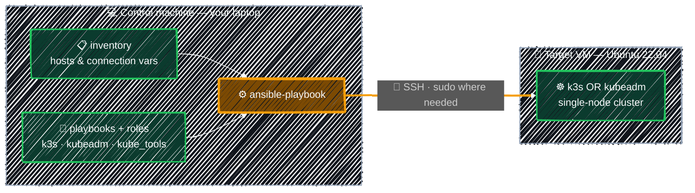

# Ansible in Practice

<p align="center">
  
</p>


[](https://github.com/r97221004/ansible-tutorial/actions/workflows/lint.yml)
[](LICENSE)
[](https://github.com/r97221004/ansible-tutorial/stargazers)

> **Problem**: Manually SSH-ing into multiple machines to install packages, copy configs, and start services is slow, repetitive, and easy to get inconsistent.
>
> **Solution**: Ansible lets you describe the desired state of your machines in YAML playbooks and apply them to any number of hosts over SSH — repeatably and idempotently.

A hands-on, example-driven Ansible refresher. Each concept is paired with a runnable playbook, and it all builds toward one concrete outcome: **provisioning a single-node Kubernetes lab (k3s or kubeadm) on a remote VM over SSH** — then tearing it back down, idempotently.



> Best for readers who already know Ansible basics and want a fast, practical refresh (~20–40 min). New to Ansible? Read top to bottom. Just refreshing? Jump straight to the [Table of Contents](#table-of-contents).

**What you'll build — one control machine driving a single-node Kubernetes lab over SSH:**



> No agent runs on the target — Ansible just needs SSH. More in [Architecture Overview](docs/getting-started/architecture.md).

## What You'll Learn

- **Drive remote machines over SSH** with ad-hoc commands and playbooks — no manual SSH sessions.
- **Write idempotent tasks** so re-running a playbook is always safe.
- **Parameterize playbooks** with inventory, `group_vars`/`host_vars`, and Ansible Vault for secrets.
- **Control flow** with `when`, `loop`, privilege escalation (`become`), and error handling.
- **Package logic into roles** and use them to install/uninstall a single-node Kubernetes lab (k3s, kubeadm) plus tooling (k9s, Helm) and GitOps (Argo CD).

## Prerequisites

- **A control machine** (your laptop) with **Ansible 2.14+** and SSH installed.
- **A target Linux VM** you can reach over SSH — examples use **Ubuntu 22.04** (e.g. an Azure VM).
- **An SSH key pair**, with the public key copied to the target (covered in [Switch to SSH Connection](docs/fundamentals/ssh-connection.md)).
- **Passwordless sudo** on the target (Azure/cloud VMs default), or a sudo password passed via `--ask-become-pass` or [Ansible Vault](docs/playbooks/vault.md).
- **Basic comfort** with the Linux shell and YAML.

> Tested with: Ansible 2.14+, Ubuntu 22.04, k3s v1.x, kubeadm/Kubernetes v1.30, k9s latest, Helm latest.

## Quick Start

Already have Ansible installed and a reachable Linux VM? Get a Kubernetes node running in four commands:

```bash
# 1. Point the inventory at your VM (edit ansible/inventory/azure.ini)
#    [control]
#    <YOUR_VM_IP> ansible_user=<YOUR_USER> ansible_connection=ssh

# 2. Confirm Ansible can reach it
ansible control -i ansible/inventory/azure.ini -m ping

# 3. Install a single-node k3s cluster
ansible-playbook -i ansible/inventory/azure.ini ansible/playbooks/install_k3s.yml

# 4. Install k9s and Helm to work with the cluster
ansible-playbook -i ansible/inventory/azure.ini ansible/playbooks/install_kube_tools.yml
```

> **Sudo password?** If your target requires a password for `sudo`, add `--ask-become-pass` to steps 3 and 4. Azure VMs and most cloud instances already have passwordless sudo configured, so no extra flag is needed. For managing secrets in a team or CI environment, see [Ansible Vault](docs/playbooks/vault.md).

Expected tail of the install run:

```
TASK [k3s : Print node status] *************************************************
ok: [<YOUR_VM_IP>] => {
    "msg": ["NAME      STATUS   ROLES                  AGE   VERSION",
            "<vm>      Ready    control-plane,master   30s   v1.x.x+k3s1"]
}

PLAY RECAP *********************************************************************
<YOUR_VM_IP> : ok=8  changed=5  unreachable=0  failed=0
```

Full prerequisites are [above](#prerequisites); the SSH setup walk-through is in [Switch to SSH Connection](docs/fundamentals/ssh-connection.md).

## Table of Contents

**Getting Started**

- [**Architecture Overview**](docs/getting-started/architecture.md) — control machine, inventory, target VM, and the repository map.
- [**Install Ansible**](docs/getting-started/install-ansible.md) — install Ansible and set up `ansible.cfg`.

**Part 1 — Fundamentals**

- [**Hello World (Local Connection)**](docs/fundamentals/hello-world.md) — your first inventory and playbook, no SSH yet.
- [**Switch to SSH Connection**](docs/fundamentals/ssh-connection.md) — key-based SSH to a remote VM.
- [**Ad-hoc Commands**](docs/fundamentals/ad-hoc-commands.md) — one-off commands without a playbook.
- [**Common Modules**](docs/fundamentals/common-modules.md) — the modules you'll use in almost every playbook.

**Part 2 — Reusable Playbooks**

- [**Idempotency**](docs/playbooks/idempotency.md) — why re-running a playbook must be safe.
- [**become**](docs/playbooks/become.md) — privilege escalation, only where needed.
- [**Variables**](docs/playbooks/variables.md) — where variables live and which one wins.
- [**when**](docs/playbooks/when.md) — conditional tasks.
- [**loop**](docs/playbooks/loop.md) — one task over a list.
- [**handlers**](docs/playbooks/handlers.md) — react only when something changed.
- [**tags**](docs/playbooks/tags.md) — run or skip part of a playbook.
- [**Error Handling**](docs/playbooks/error-handling.md) — `ignore_errors`, `failed_when`, `block`/`rescue`/`always`.
- [**Ansible Vault**](docs/playbooks/vault.md) — encrypted secrets in the repo.

**Part 3 — Scaling with Roles**

- [**Ansible Roles**](docs/roles/roles.md) — package logic into a reusable directory.
- [**k3s Role**](docs/roles/k3s.md) — lightweight single-node Kubernetes.
- [**kube_tools Role (k9s, Helm)**](docs/roles/kube-tools.md) — tooling to work with the cluster.
- [**kubeadm Role**](docs/roles/kubeadm.md) — upstream Kubernetes, step by step.
- [**argocd Role**](docs/roles/argocd.md) — Argo CD (Helm chart) plus a matching CLI.
- [**Choosing k3s vs kubeadm**](docs/roles/k3s-vs-kubeadm.md) — which cluster to practice on.

**Part 4 — Running & Operating**

- [**Testing**](docs/operating/testing.md) — integration-test roles with Molecule.
- [**Running the Playbooks**](docs/operating/running-playbooks.md) — the full lifecycle, and checking idempotency.
- [**Troubleshooting**](docs/operating/troubleshooting.md) — symptom → cause → fix.
- [**FAQ**](docs/operating/faq.md) — short answers to common questions.
- [**Next Steps**](docs/operating/next-steps.md) — where to go after this guide.
- [**Contributing**](docs/operating/contributing.md) — how to propose fixes.
