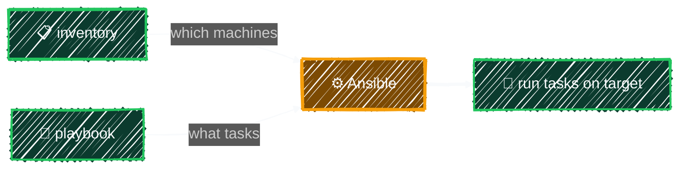

# Hello World (Local Connection)

> Your first inventory and playbook, run against your own machine — no SSH yet.

---

## Concept



## File Structure

```
ansible/
├── inventory/
│   └── localhost.ini    ← machine list
└── playbooks/
    └── hello.yml        ← task to run
```

## [inventory/localhost.ini](../../ansible/inventory/localhost.ini)

```ini
[control]
localhost ansible_connection=local ansible_user=<YOUR_USER>
```

- `[control]` → group name; it matches the group in `azure.ini`, so playbooks with `hosts: control` can run on your own machine just by passing this inventory
- `localhost` → machine name (itself)
- `ansible_connection=local` → don't use SSH, run directly on the local machine
- `ansible_user=<YOUR_USER>` → replace with your local username; the local connection doesn't log in with it, but roles use `{{ ansible_user }}` (e.g. as the kubeconfig owner)

> Because `localhost` is in the `control` group, it also picks up everything in [`group_vars/control/`](../playbooks/variables.md#group_vars--host_vars--managed-separately-from-inventory). Once you create the Vault-encrypted `group_vars/control/vault.yml` (see [Ansible Vault](../playbooks/vault.md)), local runs load it too — add `--ask-vault-pass`, and note that its `ansible_become_pass` will also be used for `sudo` on your own machine.

## [playbooks/hello.yml](../../ansible/playbooks/hello.yml)

```yaml
---
- name: Hello World
  hosts: all # runs against every host in whichever inventory you pass
  tasks:
    - name: Print message
      ansible.builtin.debug:
        msg: "Ansible is working! This machine is {{ ansible_hostname }}"

    - name: Check OS
      ansible.builtin.debug:
        msg: "OS: {{ ansible_distribution }} {{ ansible_distribution_version }}"
```

- `hosts` → which group to run against (`all` = every host in the inventory you pass)
- `tasks` → list of tasks to execute
- `debug` → module that prints to the screen
- `{{ }}` → variable syntax, automatically gathered by Ansible during the Gathering Facts phase

## Run

```bash
ansible-playbook -i ansible/inventory/localhost.ini ansible/playbooks/hello.yml
```

## Reading the Output

```
TASK [Gathering Facts]   ← automatically gathers machine info (IP, OS, hostname...)
TASK [Print message]     ← ok = success
TASK [Check OS]          ← ok = success

PLAY RECAP
  ok=3      ← all 3 tasks succeeded
  failed=0  ← no failures
```

---

[← Install Ansible](../getting-started/install-ansible.md) · [↑ Contents](../../README.md) · [Switch to SSH Connection →](ssh-connection.md)
