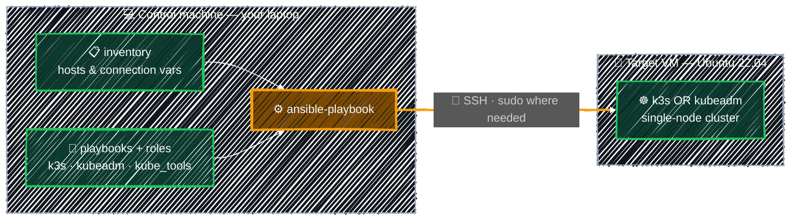

# Architecture Overview

> How the control machine, inventory, playbooks, and target VM fit together — and where everything lives in this repo.

---



- You run `ansible-playbook` on the **control machine**; no agent is installed on the target — Ansible just needs SSH access.
- Ansible reads the **inventory** (which hosts, how to connect) and the **playbooks + roles** (what to do) independently, then connects over **SSH** and applies the tasks on the **target VM**.
- The same playbook works for one VM or many — you only change the inventory.

## Repository Map

```
ansible/
├── ansible.cfg                 # default inventory + SSH behavior
├── inventory/
│   ├── localhost.ini           # [control] group pointing at your own machine
│   ├── azure.ini               # [control]/[node] groups for remote VMs  ← edit this
│   ├── group_vars/control/     # vars.yml (plain) + vault.yml (encrypted)
│   └── host_vars/              # per-host variables
└── playbooks/
    ├── hello.yml               # first playbook (debug output)
    ├── demo_variables.yml      # variables + Vault demo
    ├── install_*.yml           # install entrypoints (k3s, kubeadm, kube_tools, argocd)
    ├── uninstall_*.yml         # matching uninstall entrypoints
    └── roles/                  # reusable logic
        ├── k3s/                # lightweight single-node Kubernetes
        ├── kubeadm/            # upstream Kubernetes (containerd + flannel)
        ├── kube_tools/         # k9s terminal UI + Helm
        └── argocd/             # Argo CD (Helm chart) + matching CLI
requirements.yml                # Ansible collections (kubernetes.core) for the argocd role
```

> Start in `inventory/azure.ini` (set your VM), then run a playbook from `playbooks/`.

---

[↑ Contents](../../README.md) · [Install Ansible →](install-ansible.md)
