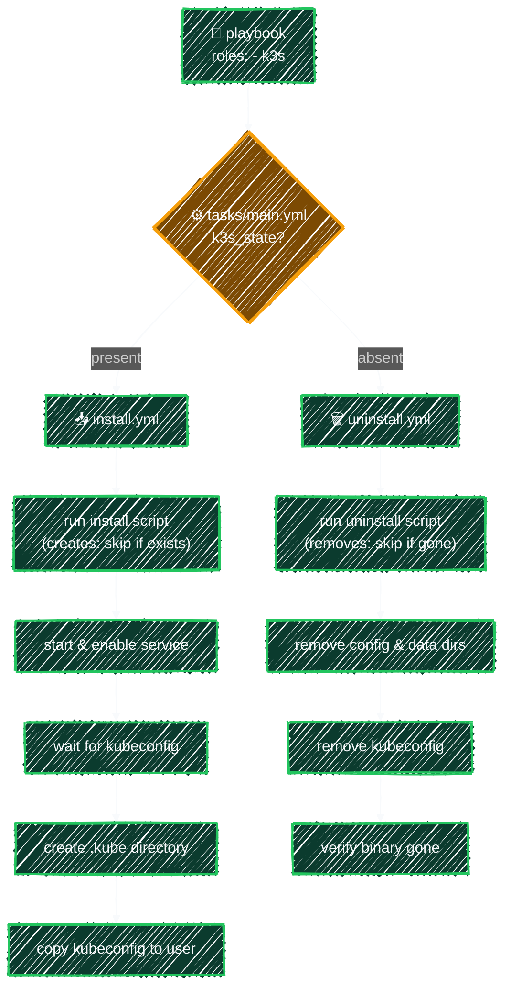

# k3s Role

> Install and uninstall a lightweight single-node Kubernetes cluster with one role.

---



**[roles/k3s/defaults/main.yml](../../ansible/playbooks/roles/k3s/defaults/main.yml)**

```yaml
---
# Default variables for the k3s role; override in inventory or the playbook

# present = install, absent = uninstall
k3s_state: present

# Which regular user should own kubeconfig (defaults to the connecting ansible_user)
k3s_user: "{{ ansible_user }}"

# k3s official install script source
k3s_install_url: https://get.k3s.io
```

- `k3s_state` → controls which task file `tasks/main.yml` runs (see [Ansible Roles](roles.md))
- `k3s_user` → defaults to `ansible_user` from the inventory, so kubeconfig ends up owned by the right login user
- `k3s_install_url` → k3s's official install script, kept as a variable so it can be overridden (e.g. for a mirror)

**[roles/k3s/tasks/main.yml](../../ansible/playbooks/roles/k3s/tasks/main.yml)**

```yaml
---
# Dispatch to install or uninstall based on k3s_state; details live in each task file
- name: Install k3s
  ansible.builtin.include_tasks: install.yml
  when: k3s_state == "present"

- name: Uninstall k3s
  ansible.builtin.include_tasks: uninstall.yml
  when: k3s_state == "absent"
```

There are two ways to pull in another task file, and they differ in **when** the file is read:

- `include_tasks` → **dynamic**: the file is loaded at runtime, only when Ansible reaches this task. Because the `when` is evaluated first, the other branch's file is never even opened — ideal for this kind of conditional dispatch.
- `import_tasks` → **static**: the file's tasks are pulled in at parse time (before the play runs), as if written inline. Ansible validates the whole sequence upfront and runs them in a fixed order — better for an ordered pipeline (the kubeadm role uses this; see [kubeadm Role](kubeadm.md)).

## Install — [tasks/install.yml](../../ansible/playbooks/roles/k3s/tasks/install.yml)

```yaml
---
- name: Download and run the k3s install script
  ansible.builtin.shell: curl -sfL {{ k3s_install_url }} | sh -
  args:
    creates: /usr/local/bin/k3s # skip if the binary already exists (idempotent)

- name: Ensure k3s is running and enabled on boot
  ansible.builtin.systemd:
    name: k3s
    state: started
    enabled: true

- name: Wait for kubeconfig to be generated
  ansible.builtin.wait_for:
    path: /etc/rancher/k3s/k3s.yaml
    state: present
    timeout: 60 # on a fresh install, k3s needs a moment after start to write this file

- name: Query node status
  ansible.builtin.command: k3s kubectl get nodes
  register: k3s_nodes
  changed_when: false # read-only query, never a change

- name: Print node status
  ansible.builtin.debug:
    msg: "{{ k3s_nodes.stdout_lines }}"

- name: Create the .kube directory
  ansible.builtin.file:
    path: "/home/{{ k3s_user }}/.kube"
    state: directory
    owner: "{{ k3s_user }}"
    mode: "0755"

- name: Copy kubeconfig to the regular user
  ansible.builtin.copy:
    src: /etc/rancher/k3s/k3s.yaml
    dest: "/home/{{ k3s_user }}/.kube/config"
    owner: "{{ k3s_user }}"
    mode: "0600" # contains credentials, owner read/write only
    remote_src: true
```

- `creates: /usr/local/bin/k3s` → on re-runs, the install script is skipped entirely
- `wait_for: ... state: present` → on a fresh install, k3s needs a moment after the service starts before it writes `/etc/rancher/k3s/k3s.yaml`; this waits for the file instead of racing it
- `changed_when: false` → this is a read-only query, so it never reports `changed`
- `remote_src: true` → `/etc/rancher/k3s/k3s.yaml` is read from the **target machine**, not the control machine

## Uninstall — [tasks/uninstall.yml](../../ansible/playbooks/roles/k3s/tasks/uninstall.yml)

```yaml
---
- name: Run the k3s uninstall script
  ansible.builtin.command: /usr/local/bin/k3s-uninstall.sh
  args:
    removes: /usr/local/bin/k3s # skip if the binary is already gone

- name: Remove k3s config and data directories
  ansible.builtin.file:
    path: "{{ item }}"
    state: absent
  loop:
    - /etc/rancher
    - /var/lib/rancher

- name: Remove kubeconfig
  ansible.builtin.file:
    path: "/home/{{ k3s_user }}/.kube/config"
    state: absent

- name: Confirm the k3s binary is removed
  ansible.builtin.stat:
    path: /usr/local/bin/k3s
  register: k3s_binary

- name: Print the uninstall result
  ansible.builtin.debug:
    msg: "{{ 'k3s uninstalled successfully' if not k3s_binary.stat.exists else 'k3s is still present, uninstall failed' }}"
```

- `removes: /usr/local/bin/k3s` → the opposite of `creates:`; skips the script once k3s is already gone
- `/etc/rancher` / `/var/lib/rancher` → removed again here in case the uninstall script left anything behind
- final `debug` → reports success/failure based on whether the binary is actually gone

## Run

Same role, two playbooks — only the `roles:` entry differs:

```yaml
# playbooks/install_k3s.yml — k3s_state defaults to "present"
---
- name: Install K3s cluster
  hosts: control
  become: true # install / systemd / reading /etc/rancher all need root
  roles:
    - k3s
```

```yaml
# playbooks/uninstall_k3s.yml — overrides k3s_state to "absent"
---
- name: Uninstall K3s cluster
  hosts: control
  become: true
  roles:
    - role: k3s
      k3s_state: absent
```

```bash
ansible-playbook -i ansible/inventory/azure.ini ansible/playbooks/install_k3s.yml
ansible-playbook -i ansible/inventory/azure.ini ansible/playbooks/uninstall_k3s.yml
```

## Verify

```bash
k3s --version                # check version
k3s kubectl get nodes         # confirm node status is Ready
k3s kubectl get pods -A       # view pods across all namespaces
sudo systemctl status k3s     # confirm the service is running
```

---

[← Ansible Roles](roles.md) · [↑ Contents](../../README.md) · [kube_tools Role (k9s, Helm) →](kube-tools.md)
