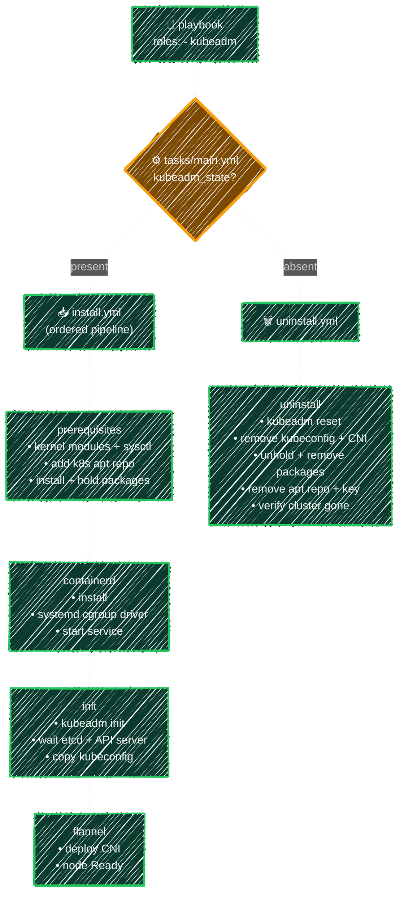

# kubeadm Role

> Build upstream Kubernetes step by step — prerequisites, containerd, `kubeadm init`, and flannel.

---

The `kubeadm` role builds an **upstream Kubernetes** single-node control plane — closer to a "real" cluster than k3s, at the cost of more moving parts. Unlike k3s (one install script), kubeadm needs the container runtime, kernel settings, and a CNI wired up by hand, so the role splits the work into a pipeline of task files.



**[roles/kubeadm/tasks/main.yml](../../ansible/playbooks/roles/kubeadm/tasks/main.yml)** dispatches on state, same pattern as the other roles:

```yaml
---
- name: Install kubeadm cluster
  ansible.builtin.include_tasks: install.yml
  when: kubeadm_state == "present"

- name: Uninstall kubeadm cluster
  ansible.builtin.include_tasks: uninstall.yml
  when: kubeadm_state == "absent"
```

**The install pipeline** — `tasks/install.yml` calls these in order:

```
prerequisites.yml → containerd.yml → init.yml → flannel.yml
```

| Step                | What it does                                                                                                                                          |
| ------------------- | ----------------------------------------------------------------------------------------------------------------------------------------------------- |
| `prerequisites.yml` | Loads kernel modules (`overlay`, `br_netfilter`), sets sysctl, adds the Kubernetes apt repo, installs and version-locks `kubelet`/`kubeadm`/`kubectl` |
| `containerd.yml`    | Installs containerd, switches it to the **systemd cgroup driver** (required by kubelet), restarts it via a handler                                    |
| `init.yml`          | Runs `kubeadm init`, waits for etcd/API server, then copies kubeconfig to the user                                                                    |
| `flannel.yml`       | Deploys the **flannel** CNI so pods can network and the node turns `Ready`                                                                            |

> The order matters: the runtime and kernel settings must exist before `kubeadm init`, and the cluster must be initialized before a CNI can be applied. `import_tasks` (unlike `include_tasks`) is processed **statically at parse time** — Ansible validates the full sequence before running anything and tasks run in a fixed, guaranteed order.

**[tasks/install.yml](../../ansible/playbooks/roles/kubeadm/tasks/install.yml)**

```yaml
---
- name: Install prerequisites (kernel modules, sysctl, apt repo, packages)
  ansible.builtin.import_tasks: prerequisites.yml

- name: Install and configure containerd
  ansible.builtin.import_tasks: containerd.yml

- name: Initialize the cluster with kubeadm
  ansible.builtin.import_tasks: init.yml

- name: Deploy the flannel CNI
  ansible.builtin.import_tasks: flannel.yml
```

## [prerequisites.yml](../../ansible/playbooks/roles/kubeadm/tasks/prerequisites.yml)

```yaml
---
- name: Configure kernel modules to load on boot (overlay, br_netfilter)
  ansible.builtin.copy:
    dest: /etc/modules-load.d/k8s.conf
    content: |
      overlay
      br_netfilter
    mode: "0644"

- name: Load the overlay and br_netfilter kernel modules now
  ansible.builtin.command: modprobe {{ item }}
  loop:
    - overlay
    - br_netfilter
  changed_when: false

- name: Set the sysctl parameters required by Kubernetes
  ansible.builtin.copy:
    dest: /etc/sysctl.d/k8s.conf
    content: |
      net.bridge.bridge-nf-call-iptables = 1
      net.bridge.bridge-nf-call-ip6tables = 1
      net.ipv4.ip_forward = 1
    mode: "0644"
  register: k8s_sysctl

- name: Apply the sysctl settings
  ansible.builtin.command: sysctl --system
  when: k8s_sysctl.changed
  changed_when: true

- name: Update the apt cache
  ansible.builtin.apt:
    update_cache: true
  ignore_errors: true

- name: Install prerequisite packages
  ansible.builtin.apt:
    name:
      - apt-transport-https
      - ca-certificates
      - curl
      - gpg
    state: present

- name: Create the keyrings directory
  ansible.builtin.file:
    path: /etc/apt/keyrings
    state: directory
    mode: "0755"

- name: Download the Kubernetes apt key
  ansible.builtin.shell: |
    curl -fsSL https://pkgs.k8s.io/core:/stable:/v1.30/deb/Release.key | \
    gpg --dearmor -o /etc/apt/keyrings/kubernetes-apt-keyring.gpg
  args:
    creates: /etc/apt/keyrings/kubernetes-apt-keyring.gpg

- name: Add the Kubernetes apt repository
  ansible.builtin.lineinfile:
    path: /etc/apt/sources.list.d/kubernetes.list
    line: "deb [signed-by=/etc/apt/keyrings/kubernetes-apt-keyring.gpg] https://pkgs.k8s.io/core:/stable:/v1.30/deb/ /"
    create: true
    mode: "0644"

- name: Install kubelet kubeadm kubectl
  ansible.builtin.apt:
    name:
      - kubelet
      - kubeadm
      - kubectl
    state: present
    update_cache: true

- name: Hold the versions to prevent automatic upgrades
  ansible.builtin.dpkg_selections:
    name: "{{ item }}"
    selection: hold
  loop:
    - kubelet
    - kubeadm
    - kubectl
```

- `modprobe` with `changed_when: false` — loading a module that's already loaded is a no-op but still exits 0, so Ansible can't detect "change"; mark it explicitly
- `register: k8s_sysctl` + `when: k8s_sysctl.changed` — only re-apply sysctl if the config file was actually written; re-running `sysctl --system` on every play would be noise
- `creates:` on the apt key download — re-running the curl-pipe-gpg command on a key that's already there would error; skip it once the file exists
- `dpkg_selections: selection: hold` — pins the versions so `apt upgrade` won't accidentally upgrade kubelet mid-cluster

## [containerd.yml](../../ansible/playbooks/roles/kubeadm/tasks/containerd.yml)

```yaml
---
- name: Install containerd
  ansible.builtin.apt:
    name: containerd
    state: present

- name: Create the containerd config directory
  ansible.builtin.file:
    path: /etc/containerd
    state: directory
    mode: "0755"

- name: Generate the default containerd config
  ansible.builtin.shell: containerd config default > /etc/containerd/config.toml
  args:
    creates: /etc/containerd/config.toml

- name: Configure containerd to use the systemd cgroup driver
  ansible.builtin.lineinfile:
    path: /etc/containerd/config.toml
    regexp: "SystemdCgroup = false"
    line: "            SystemdCgroup = true"
  notify: Restart containerd

- name: Start the containerd service
  ansible.builtin.systemd:
    name: containerd
    state: started
    enabled: true
```

- `notify: Restart containerd` — the handler itself is defined in [`handlers/main.yml`](../../ansible/playbooks/roles/kubeadm/handlers/main.yml) (shown below); if `lineinfile` changes the cgroup setting, the handler queues a restart; on re-runs where the line is already correct, the task reports `ok` and the handler is never queued — see [handlers](../playbooks/handlers.md)
- `creates: /etc/containerd/config.toml` — only generate the default config once; on re-runs `lineinfile` checks whether the cgroup line is already correct without regenerating the whole file

## [init.yml](../../ansible/playbooks/roles/kubeadm/tasks/init.yml)

```yaml
---
- name: Initialize the kubeadm cluster
  ansible.builtin.shell: >
    kubeadm init
    --apiserver-advertise-address={{ ansible_default_ipv4.address }}
    --apiserver-cert-extra-sans={{ ansible_host }}
    --pod-network-cidr=10.244.0.0/16
    --cri-socket=unix:///var/run/containerd/containerd.sock
  args:
    creates: /etc/kubernetes/admin.conf

- name: Wait for etcd to be ready
  ansible.builtin.wait_for:
    host: "{{ ansible_default_ipv4.address }}"
    port: 2379
    delay: 10
    timeout: 120

- name: Wait for the API server to be ready
  ansible.builtin.wait_for:
    host: "{{ ansible_default_ipv4.address }}"
    port: 6443
    delay: 30
    timeout: 180

- name: Create the .kube directory
  ansible.builtin.file:
    path: /home/{{ kubeadm_user }}/.kube
    state: directory
    owner: "{{ kubeadm_user }}"
    mode: "0755"

- name: Copy kubeconfig
  ansible.builtin.copy:
    src: /etc/kubernetes/admin.conf
    dest: /home/{{ kubeadm_user }}/.kube/config
    owner: "{{ kubeadm_user }}"
    mode: "0600"
    remote_src: true
```

- `creates: /etc/kubernetes/admin.conf` — `kubeadm init` on an already-initialized node would error; skip it once the admin config exists
- `wait_for: port: 2379 / 6443` — etcd and the API server take several seconds to come up after init; `flannel.yml` needs the API server reachable before it can `kubectl apply`

## [flannel.yml](../../ansible/playbooks/roles/kubeadm/tasks/flannel.yml)

```yaml
---
- name: Download the flannel manifest
  ansible.builtin.get_url:
    url: https://github.com/flannel-io/flannel/releases/latest/download/kube-flannel.yml
    dest: /tmp/kube-flannel.yml
    mode: "0644"

- name: Pin flannel to the chosen network interface
  ansible.builtin.lineinfile:
    path: /tmp/kube-flannel.yml
    insertafter: "- --kube-subnet-mgr"
    regexp: "^\\s*- --iface="
    line: "        - --iface={{ flannel_iface }}"

- name: Deploy flannel
  ansible.builtin.command: kubectl apply -f /tmp/kube-flannel.yml
  environment:
    KUBECONFIG: /etc/kubernetes/admin.conf
  register: flannel_apply
  changed_when: "'created' in flannel_apply.stdout or 'configured' in flannel_apply.stdout"

- name: Query node status
  ansible.builtin.command: kubectl get nodes
  environment:
    KUBECONFIG: /etc/kubernetes/admin.conf
  register: kubeadm_nodes
  changed_when: false

- name: Print node status
  ansible.builtin.debug:
    msg: "{{ kubeadm_nodes.stdout_lines }}"
```

- `lineinfile: regexp: / line:` — idempotent patch: if `--iface=eth0` is already in the manifest it replaces it; if not, it inserts after `--kube-subnet-mgr`; re-running produces the same result
- `environment: KUBECONFIG:` — root doesn't have `~/.kube/config` at this point; setting `KUBECONFIG` inline targets the admin config without permanently copying it

## Uninstall — [tasks/uninstall.yml](../../ansible/playbooks/roles/kubeadm/tasks/uninstall.yml)

```yaml
---
- name: Run kubeadm reset
  ansible.builtin.command: kubeadm reset -f --cri-socket=unix:///var/run/containerd/containerd.sock
  args:
    removes: /etc/kubernetes/admin.conf

- name: Remove kubeconfig
  ansible.builtin.file:
    path: /home/{{ kubeadm_user }}/.kube/config
    state: absent

- name: Remove the CNI config
  ansible.builtin.file:
    path: /etc/cni/net.d
    state: absent

- name: Unhold the versions to allow removal
  ansible.builtin.dpkg_selections:
    name: "{{ item }}"
    selection: install
  loop:
    - kubelet
    - kubeadm
    - kubectl

- name: Remove kubelet kubeadm kubectl
  ansible.builtin.apt:
    name:
      - kubelet
      - kubeadm
      - kubectl
    state: absent

- name: Remove the Kubernetes apt repository
  ansible.builtin.file:
    path: /etc/apt/sources.list.d/kubernetes.list
    state: absent

- name: Remove the Kubernetes apt key
  ansible.builtin.file:
    path: /etc/apt/keyrings/kubernetes-apt-keyring.gpg
    state: absent

- name: Confirm the cluster config is removed
  ansible.builtin.stat:
    path: /etc/kubernetes/admin.conf
  register: kubeadm_admin_conf

- name: Print the uninstall result
  ansible.builtin.debug:
    msg: "{{ 'kubeadm uninstalled successfully' if not kubeadm_admin_conf.stat.exists else 'kubeadm is still present, uninstall failed' }}"
```

- `removes: /etc/kubernetes/admin.conf` — `kubeadm reset` on an already-clean node would error; `removes:` skips it if the cluster is already gone
- unhold before removal — `apt remove` fails on held packages; `dpkg_selections: selection: install` releases the hold first
- removes the apt repo and key — so a future `apt update` doesn't try to reach a repo that's no longer needed

**[handlers/main.yml](../../ansible/playbooks/roles/kubeadm/handlers/main.yml)**

```yaml
---
- name: Restart containerd
  ansible.builtin.systemd:
    name: containerd
    state: restarted

- name: Restart kubelet
  ansible.builtin.systemd:
    name: kubelet
    state: restarted
```

The handler name must exactly match the string passed to `notify:` in the task files. Both handlers run at the end of the play — not at the point where `notify:` appears — and only if their notifying task reported `changed`.

**[roles/kubeadm/defaults/main.yml](../../ansible/playbooks/roles/kubeadm/defaults/main.yml)**

```yaml
---
# present = install, absent = uninstall
kubeadm_state: present

# Which regular user should own kubeconfig (defaults to the connecting ansible_user)
kubeadm_user: "{{ ansible_user }}"

# Network interface flannel should advertise on
flannel_iface: "eth0"
```

> Like the k3s role, `kubeadm_user` lives in `defaults` rather than being hardcoded — so install and uninstall always target the same user even if you change the connecting account.

## Run

```yaml
# playbooks/install_kubeadm.yml
---
- name: Install kubeadm cluster
  hosts: control
  become: true
  roles:
    - kubeadm
```

```bash
ansible-playbook -i ansible/inventory/azure.ini ansible/playbooks/install_kubeadm.yml
ansible-playbook -i ansible/inventory/azure.ini ansible/playbooks/uninstall_kubeadm.yml
```

> First-time `kubeadm init` pulls several container images, so the install takes noticeably longer than k3s. Re-runs are idempotent — `creates:` on the `kubeadm init` step skips re-initializing an existing cluster.

## Verify

The install run already prints node status at the end (the `flannel.yml` step runs `kubectl get nodes`), and the uninstall run prints whether `/etc/kubernetes/admin.conf` is gone — same confidence checks as the k3s role. You can re-check manually any time:

```bash
kubectl get nodes              # node should reach Ready once flannel is up
kubectl get pods -A            # kube-system + flannel pods Running
kubectl cluster-info
```

> A fresh node may show `NotReady` for a few seconds until the flannel pod starts — re-run `kubectl get nodes` and it should flip to `Ready`.

---

[← kube_tools Role (k9s, Helm)](kube-tools.md) · [↑ Contents](../../README.md) · [argocd Role →](argocd.md)
